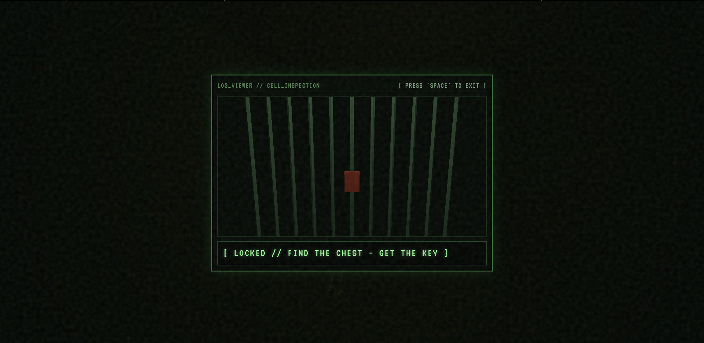
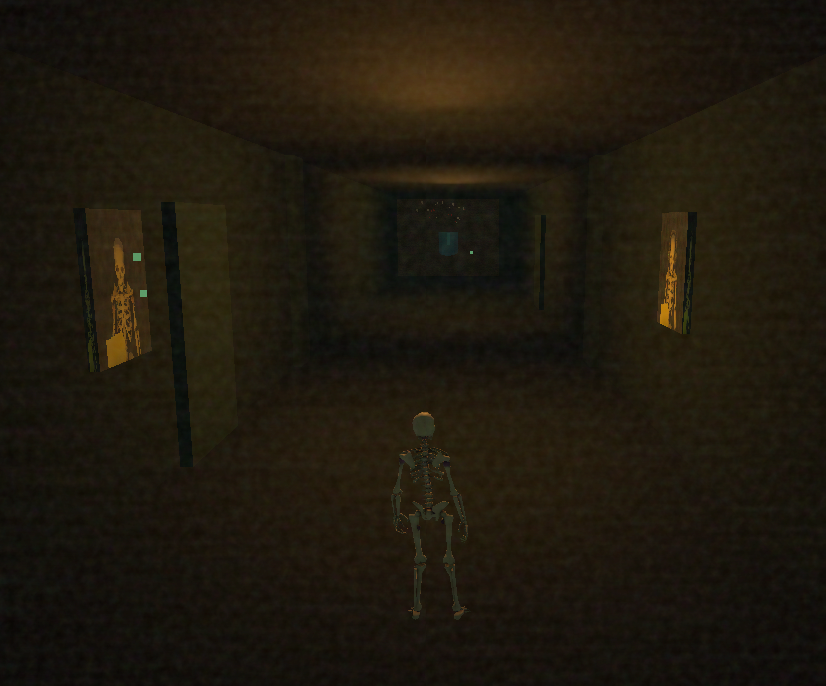

# Noctambulism

Noctambulism is a web-game that brings back that low-poly, PS1, flat shading, aesthetic.

It is being created based on a past experience of a sleepwalking episode where the dream was an endless hallway with doors and weird green atmosphere.

After the 'Title Screen' it shows the 'Bedroom POV', once you click the door it takes you to the 'Hallway Dream', where you control a 3D skeleton model that can explore, walk around, and interact with the environment.

It is a weirdcore type of game, so you might think that something is off or wrong throughout the experience but it is all intentional.

### What is working right now?

The 'Title Screen', 'Act 1: Bedroom POV' and 'Act 2: The Hallway Dream' where you can open the doors and interact with the paintings.
*Still working on the features and interactive mechanisms*

## Controls

Use 'W, A, S, D' to move around;
Press 'E' to interact;
Press 'Space' to leave;
Press 'ESC' to go back to the 'Title Screen';

## Thechnical part

I'm using JS and Three.js for the whole mechanims and polygonal shapes, CSS and HTML to style and structure the web-game in VS Code.

Feel free to reach out to me: jamilylobi12@gmail.com

### AI DISCLOSURE

I use AI as a learning tool, to correct typos that might brake the project and I like to use it to organize my ideas as well.
Sometimes I make good use of some assets, for Noctambulism only the skeleton model was made by AI.