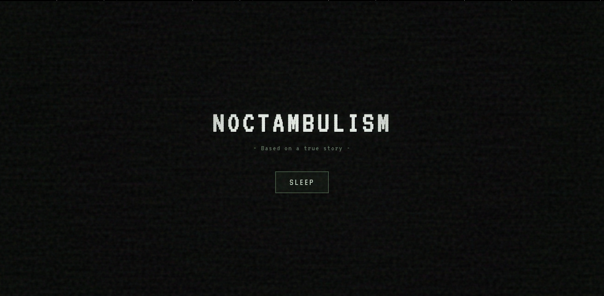
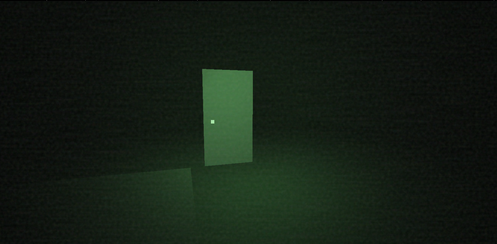
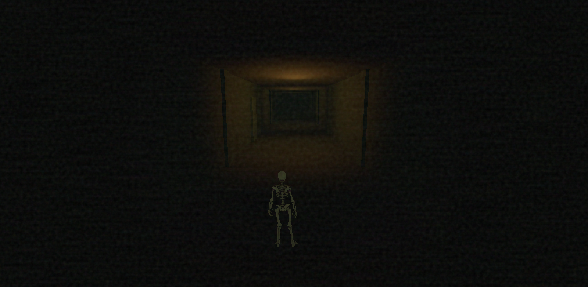
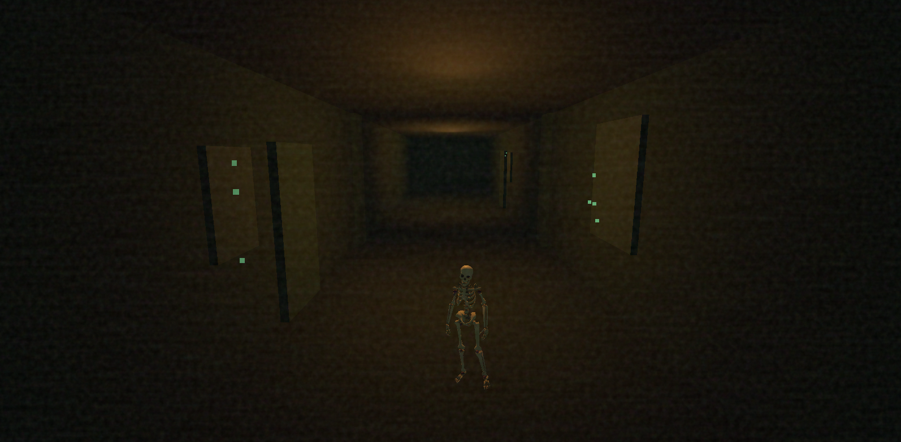
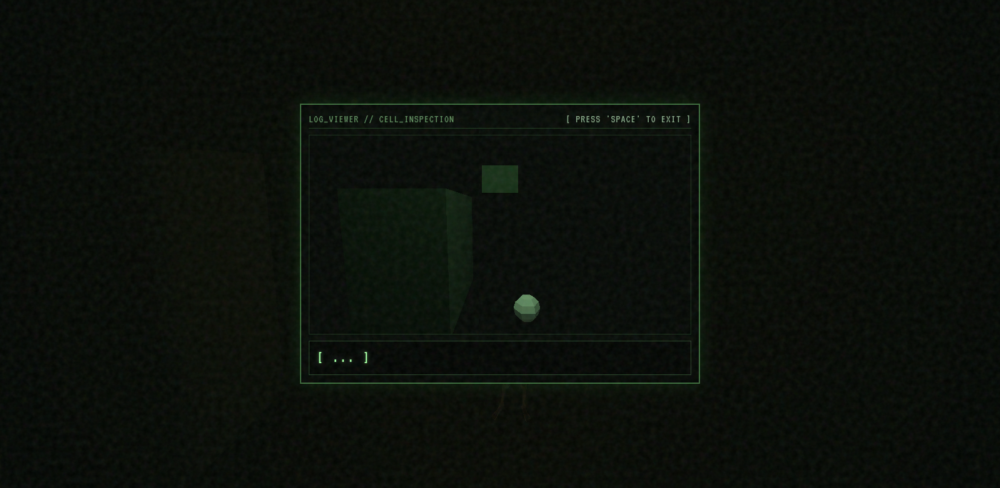
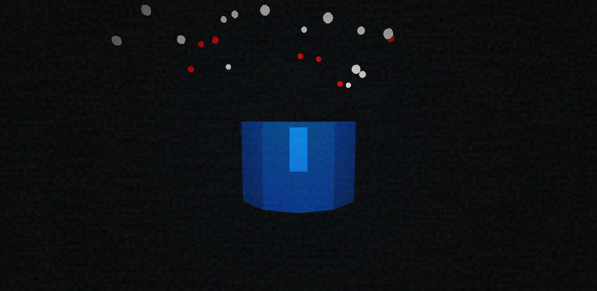

# Noctambulism

Noctambulism is a web-game that brings back that low-poly, PS1, flat shading, aesthetic.

It is being created based on a past experience of a sleepwalking episode where the dream was an endless hallway with doors and weird green atmosphere.

After the 'Title Screen' it shows the 'Bedroom POV', once you click the door it takes you to the 'Hallway Dream', where you are a skeleton and you can explore and interact with almost anything you see.
*(I'm still working on the interactive features and easter eggs)*

> It has a plot twist, which will be the 'Fall & Rise' after you explore the hallway. But it's just a concept for now, in the meantime we have the 'Radioactive Tank' and it'll zoom-in forever into the void.

It is a weirdcore type of game, so you might think that something is off or wrong throughout the experience but it is all intentional.

### What is working right now?

The 'Title Screen', 'Act 1: Bedroom POV' and 'Act 2: The Hallway Dream' which is probably the hardest part to finish, so at the moment it's lagging and kinda broken, but it's defnitely not the final form!

> Also it should play an annoying and repetitive song, but I'll change that anytime soon

### Controls

Use 'W, A, S, D' to move around;
Press 'E' to interact;
Press 'ESC' to go back to the 'Title Screen';

## Thechnical part

I'm using JS and Three.js for the whole mechanims and polygonal shapes, CSS and HTML to style and structure the web-game in VS Code.

Feel free to reach out to me: jamilylobi12@gmail.com

## AI DISCLOSURE

I use AI as a learning tool, to correct typos that might brake the project and I like to use it to organize my ideas as well.
Sometimes I make good use of some assets, for Noctambulism only the skeleton model was made by AI.